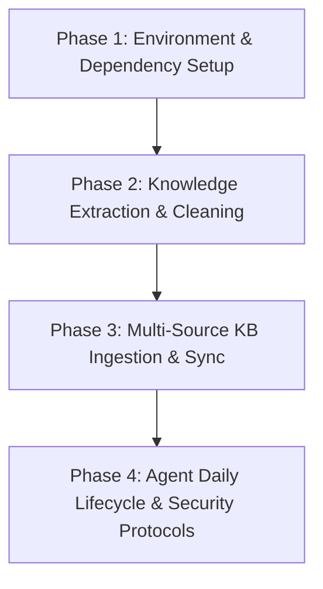
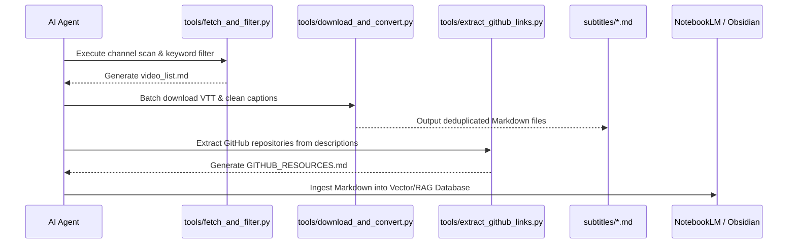

# 🤖 AI Agent System Instructions & Workflow Master Guide (`AGENTS.md`)

> **Target Audience**: AI Coding Agents (Google Antigravity, Claude Code, OpenAI Codex, Cursor, OpenCode, etc.)
> **Goal**: This document serves as an actionable, machine-readable protocol for any AI Agent to automatically environment-bootstrap, execute data extraction, parse/clean content, construct multi-source Knowledge Bases (NotebookLM/Obsidian), and enforce project lifecycle rules.

---

## 🧭 Executive Overview & Agent Execution Mandate

When an AI Agent is initialized in this repository or tasked with building/updating the **AI Agent Knowledge Base (KB)**, it MUST follow the 4-Phase Execution Workflow detailed below.



---

## 🛠️ Phase 1: Environment Bootstrapping & Verification

An AI Agent MUST verify and initialize the host system's execution environment before running any data ingestion pipelines.

### 1.1 Automated Windows Environment Setup
Execute the following PowerShell script to automatically setup `uv`, Python 3.12 virtual environment (`.venv`), and core dependencies:

```powershell
powershell -ExecutionPolicy Bypass -File .\install_windows.ps1
```

### 1.2 Automated Environment Verification
Verify that the virtual environment, core dependencies, and optional tools are working correctly:

```powershell
# 1. 核心環境依賴檢查 (必備)
.\.venv\Scripts\python.exe verify_core.py

# 2. 進階套件與字型子集化檢查 (選用)
.\.venv\Scripts\python.exe verify_optional.py

# 3. 外部服務與整合檢查 (選用)
.\.venv\Scripts\python.exe verify_external.py
```

*Required Check*: `verify_core.py` 輸出必須回傳 `[SUCCESS] All core checks passed!`。

---

## 📑 Phase 2: Knowledge Base Construction Workflow

The agent MUST follow this exact sequence to extract, clean, and format raw input data into structured Markdown knowledge base files.



### 2.1 YouTube Subtitle Knowledge Base Pipeline

#### Step 1: Channel Scan & Keyword Filtering
Run `tools/fetch_and_filter.py` with the target YouTube channel URL and relevant topic keywords to produce `video_list.md`:

```powershell
.\.venv\Scripts\python.exe tools/fetch_and_filter.py --channel "https://www.youtube.com/@sensebar" --keywords "claude,codex,antigravity,opencode,agent,n8n,ai"
```

#### Step 2: Subtitle Batch Download & VTT Cleaning
Run `tools/download_and_convert.py` to parse raw VTT files, remove timestamps/HTML tags, deduplicate scrolling line overlaps, and save cleaned Markdown documents into `subtitles/`:

```powershell
.\.venv\Scripts\python.exe tools/download_and_convert.py
```

#### Cleaning Algorithm Rules for Agents:
1. **HTML Tag Stripping**: Remove `<c>`, `</c>`, and `<00:00:00.000>` timestamps.
2. **Scroll Deduplication**: Check consecutive subtitle cues for prefix/suffix overlap. Merge accumulating lines to prevent duplicate sentence spam in RAG embeddings.

#### Step 3: GitHub Repository Extraction & Dual-Index Generation
Run `tools/extract_github_links.py` to scan all video descriptions and subtitles, extract shared GitHub open-source repositories, and output `GITHUB_RESOURCES.md`:

```powershell
.\.venv\Scripts\python.exe tools/extract_github_links.py
```

#### Step 4: Missing Video Differential Scan
Run `tools/find_missing_antigravity.py` to compare live channel videos/streams against `video_list.md` and find uncataloged tutorials:

```powershell
.\.venv\Scripts\python.exe tools/find_missing_antigravity.py
```

### 2.2 Multi-Source Data Ingestion Pipelines

For non-YouTube data sources, execute the corresponding dedicated converter in `tools/`:

* **Google Sheets Data**:
  ```powershell
  .\.venv\Scripts\python.exe tools/google_sheets_to_obsidian.py
  ```
* **Mantis Issue Tracking System**:
  ```powershell
  .\.venv\Scripts\python.exe tools/mantis_to_obsidian.py
  ```
* **Excel Spreadsheet Data**:
  ```powershell
  .\.venv\Scripts\python.exe tools/excel_to_notebooklm.py
  ```

---

## 🧠 Phase 3: Knowledge Storage & System MCP Sync

Once Markdown files are generated in `subtitles/` or specified output folders, the agent MUST sync them with external knowledge retrieval systems.

### 3.1 NotebookLM Sync Protocol
1. Verify NotebookLM CLI:
   ```powershell
   nlm doctor
   ```
2. If authentication is needed, instruct the user to run `nlm login` via interactive terminal.
3. Use NotebookLM MCP tools to query or upload documents to target notebooks.

### 3.2 Obsidian Second Brain Sync Protocol
1. Ensure Vault path contains `.obsidian` configuration folder.
2. Structure output notes following the 3-Tier Second Brain Architecture:
   - **Tier 1 (Cockpit / 駕駛艙)**: High-level dashboard, status, and active task lists (`AI_Agent_專案駕駛艙.md`).
   - **Tier 2 (Domain Knowledge / 領域知識)**: Categorized reference notes.
   - **Tier 3 (Raw Archive / 原始資料庫)**: Cleaned Markdown files (e.g., `subtitles/`).

---

## 🔄 Phase 4: Agent Daily Lifecycle & Governance Protocol

AI Agents operating within this repository MUST enforce the standard project lifecycle rules (`SENSEBAR_SYNC_WORKFLOW_V1`).

### 4.1 Start-of-Work Workflow (`開工`)
When invoked with "開工" or starting a new session, the agent MUST:
1. Read the root configuration file [ANTIGRAVITY.md](file:///D:/AI/AI_Agent/ANTIGRAVITY.md).
2. Read the Obsidian Project Cockpit note (`AI_Agent_專案駕駛艙.md`).
3. Execute `git status` and inspect recent commit logs.
4. Report current project status and propose actionable next steps.
5. **DO NOT** execute auto `git pull`, `commit`, or `push` without user confirmation.

### 4.2 End-of-Work Workflow (`收工`)
When invoked with "收工", "下班", or finishing a task, the agent MUST:
1. **Security Audit**: Scan workspace for hardcoded API keys, tokens, credentials, or private personal data.
2. Update Obsidian Cockpit note with completed tasks, next steps, and learnings.
3. Execute `git status` and `git diff`.
4. Stage **ONLY** files relevant to the current task (`git add <specific_files>`). **NEVER** use `git add .`.
5. Generate a concise, standard Git commit message, obtain confirmation, then commit and push.
6. Output a summary report of updated files and sync status.

### 4.3 Voice Response & Edge-TTS Protocol (`語音回覆`)
When requested to speak or summarize verbally ("用語音回答", "唸給我聽"):
1. Generate concise, conversational summary text (100–250 words).
2. Synthesize audio using `edge-tts` with voice `zh-TW-YunJheNeural`:
   ```python
   import asyncio, edge_tts
   asyncio.run(edge_tts.Communicate("語音總結內容...", "zh-TW-YunJheNeural").save("temp_speech.mp3"))
   ```
3. Play audio inline in Windows PowerShell via `PresentationCore.MediaPlayer`.

---

## 🧰 Phase 5: Global Skill Export (`youtube-kb-builder`)

To reuse this YouTube ingestion & GitHub extraction capability across other projects or other agents:

1. **Skill Location**: Available in the user's global skill directory at `D:\.gemini\config\skills\youtube-kb-builder\`.
2. **Standard Structure**:
   - `SKILL.md`: Skill definition and execution contract.
   - `scripts/`: Self-contained Python scripts (`fetch_and_filter.py`, `download_and_convert.py`, `extract_github_links.py`, `find_missing_videos.py`).
3. **Usage in Any Project**: An agent in any directory can trigger this capability simply by calling the scripts in the skill folder.

---

## 🔒 Security & Code Audit Rules for AI Agents

1. **No Guessing**: Never guess API parameters, schemas, or file paths without inspecting source files.
2. **Empirical Verification**: Never claim a feature is fixed or built without executing build/test verification commands.
3. **Secret Protection**:
   * NEVER commit `.env`, `*key*.json`, Firebase Admin credentials, or personal tokens.
   * Verify `.gitignore` rules before pushing.

---

## 📂 Repository File Index

| File / Directory | Description |
|---|---|
| [AGENTS.md](file:///D:/AI/AI_Agent/AGENTS.md) | **This Document**: Comprehensive AI Agent System Prompt & Execution Guide |
| [ANTIGRAVITY.md](file:///D:/AI/AI_Agent/ANTIGRAVITY.md) | Project entry point, basic metadata, and Do/Don't rules |
| [README.md](file:///D:/AI/AI_Agent/README.md) | User-facing repository overview & quickstart |
| [GITHUB_RESOURCES.md](file:///D:/AI/AI_Agent/GITHUB_RESOURCES.md) | Dual-indexed catalog of all GitHub open-source repositories from tutorials |
| `video_list.md` | List of target YouTube video URLs (65+ videos) |
| `subtitles/` | Cleaned Markdown files converted from VTT captions |
| `tools/fetch_and_filter.py` | YouTube channel video scanner & keyword filter |
| `tools/download_and_convert.py` | Subtitle downloader & scroll-deduplication cleaner |
| `tools/extract_github_links.py` | Automatic GitHub repo extractor from video descriptions |
| `tools/find_missing_antigravity.py` | Missing tutorial scanner via live channel comparison |
| `tools/batch_add_and_extract.py` | One-click batch append, download, clean, and extract tool |
| `tools/convert_pending.py` | Safe VTT-to-Markdown batch converter avoiding shell pipe escaping |
| `install_windows.ps1` | One-click PowerShell environment setup script |
| `verify_core.py` | Core environment verification script |
| `verify_optional.py` | Optional packages and font subsetting verification script |
| `verify_external.py` | External services and integration verification script |
