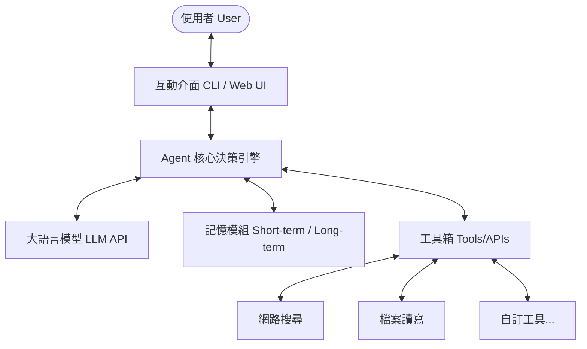

# AI Agent 專案工作藍圖 (Project Blueprint)

本文件用於記錄 `AI_Agent` 專案的開發目標、工作藍圖、架構設計以及任務進度，作為後續開發與協作的依據。

---

## 📌 專案簡介 (Project Overview)
本專案旨在開發一個智慧型 AI Agent，具備自主規劃、工具呼叫（Tool Use）、記憶管理（Memory Management）以及與使用者互動的能力。

---

## 🗺️ 開發工作藍圖 (Roadmap)

### 🚀 階段一：需求分析與基礎環境建置 (Phase 1: Environment & Requirements)
- [ ] 釐清 AI Agent 的具體應用場景與核心需求。
- [ ] 確定開發語言（如 Python / TypeScript）與框架選型（如 LangChain / LangGraph / AutoGen 或純原生開發）。
- [ ] 初始化專案結構，建立版本控制（Git）與虛擬環境。
- [ ] 設定金鑰管理（.env 檔）與基礎依賴套件。

### 🏗️ 階段二：核心架構設計與實現 (Phase 2: Core Architecture)
- [ ] **LLM 整合層**：串接大語言模型 API（如 Gemini API、OpenAI API）。
- [ ] **提示詞工程（Prompt Engineering）**：設計系統提示詞（System Prompts）以定義 Agent 的角色與行為。
- [ ] **工具箱設計（Tools/Plugins）**：實作 Agent 可以呼叫的工具（例如：網頁搜尋、檔案讀寫、計算機等）。
- [ ] **代理控制流（Agent Loop/Reasoning）**：實現 ReAct（Reasoning and Acting）或其他決策循環邏輯。

### 🧠 階段三：記憶與狀態管理 (Phase 3: Memory & State Management)
- [ ] **短期記憶**：維護對話上下文（Chat History）。
- [ ] **長期記憶**：串接向量資料庫（Vector DB，如 Chroma / Pinecone）進行 RAG（檢索增強生成）或長期知識儲存。
- [ ] **狀態保存**：支援中斷後重啟、對話狀態持久化。

### 🧪 階段四：測試、優化與部署 (Phase 4: Testing, Optimization & Deployment)
- [ ] 設計測試案例，驗證 Agent 的工具呼叫準確性與對話流暢度。
- [ ] 優化提示詞，減少 token 消耗並降低幻覺（Hallucination）。
- [ ] 提供使用者介面（CLI、Web UI 或 API 接口）。
- [ ] 部署至執行環境，並建立監控與日誌記錄（Logging）。

---

## 📐 架構示意圖 (Architecture)

---

## 📝 當前任務清單 (Task Checklist)

- [ ] **環境初始化**
  - [ ] 建立專案基礎目錄結構
  - [ ] 初始化 Git 版本控制
  - [ ] 撰寫基礎讀我檔案 (`README.md`)
- [ ] **技術選型與規格制定**
  - [ ] 決定 Agent 應用方向（請與使用者確認）
  - [ ] 選擇適合的框架與套件
- [ ] **核心原型開發**
  - [ ] 實作最簡易的 LLM 串接測試
  - [ ] 實作單一工具呼叫測試
